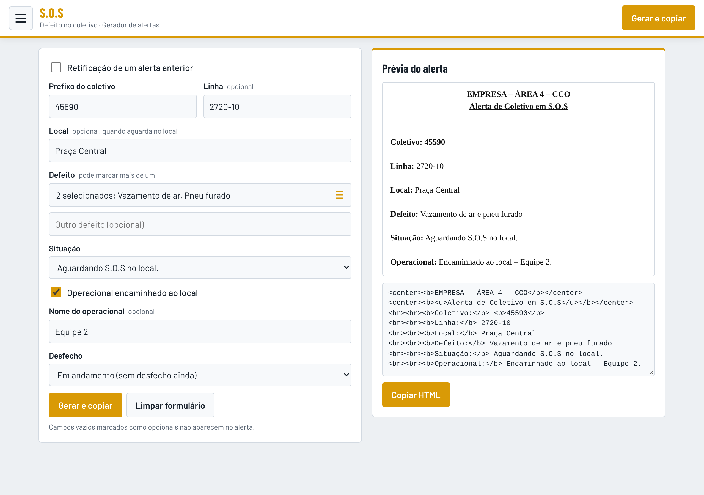
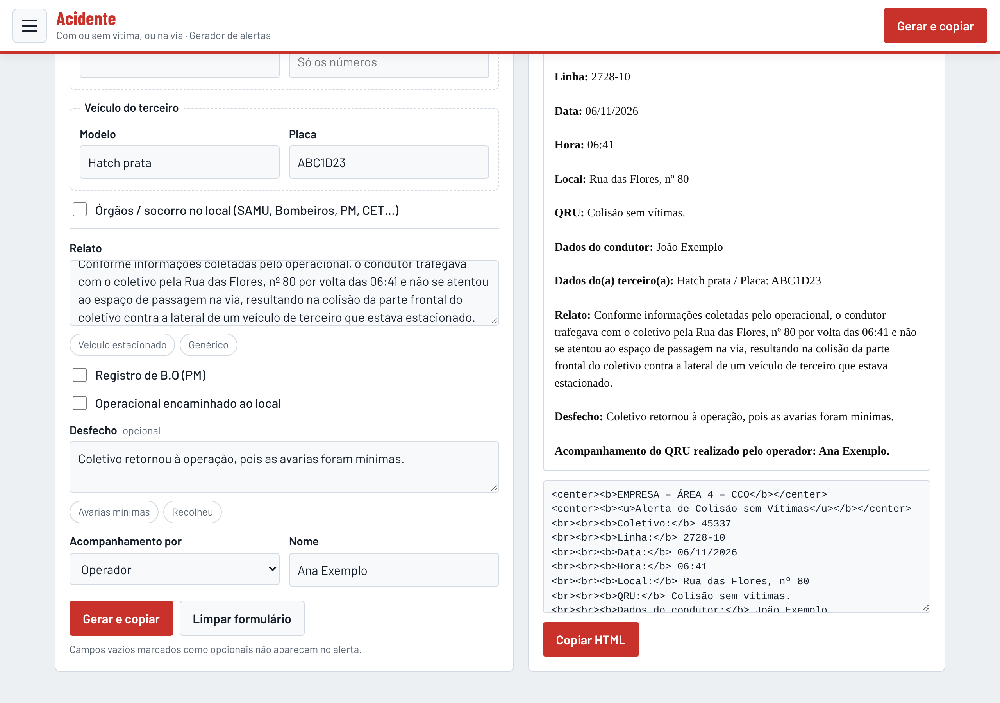
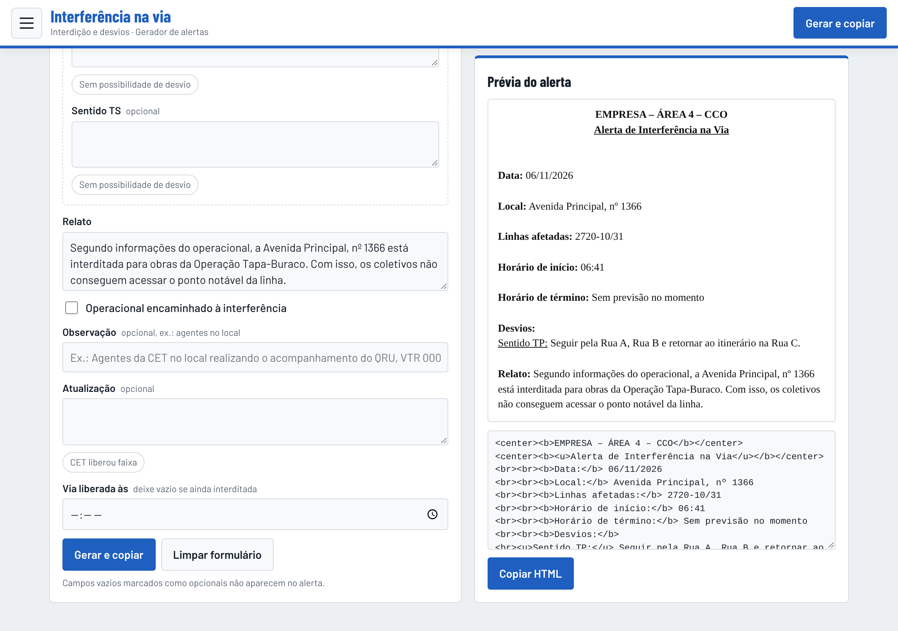
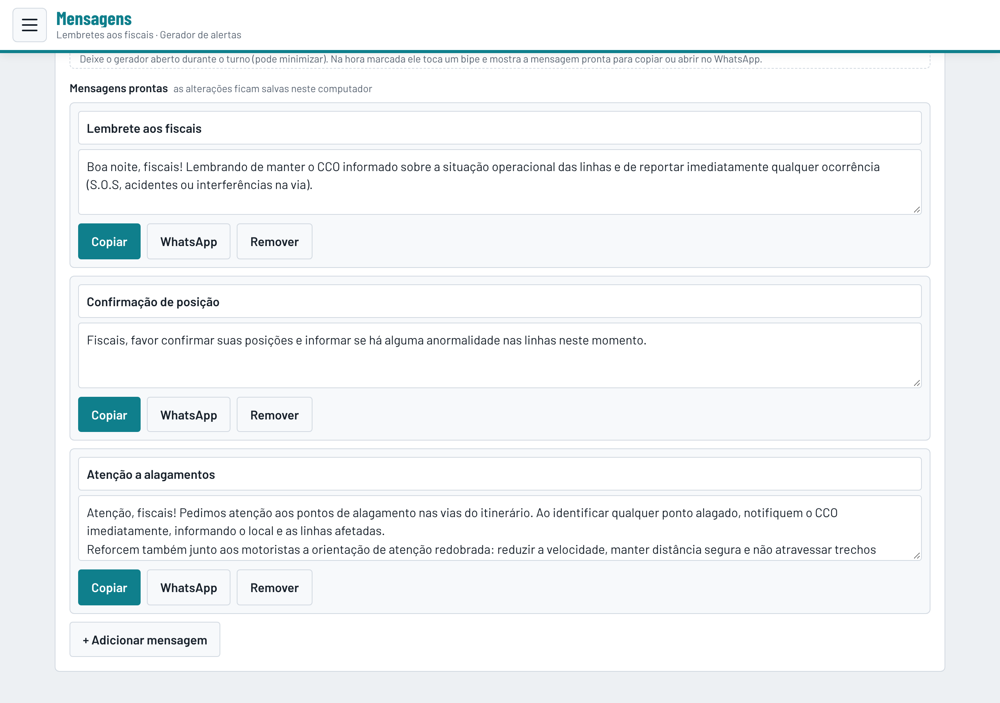
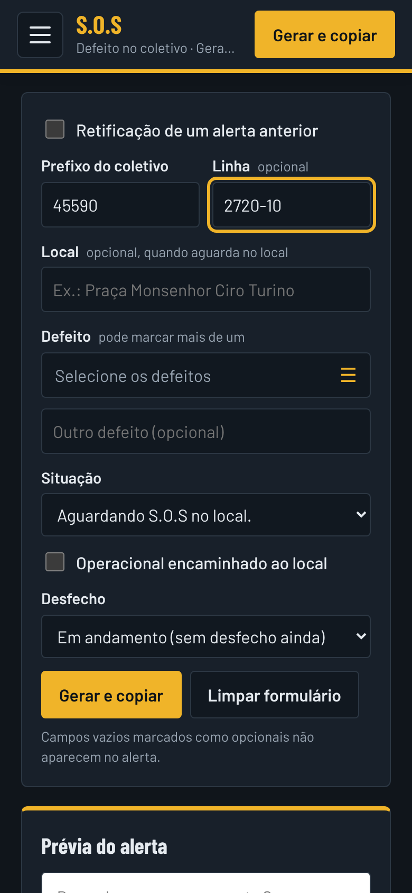

# Gerador de Alertas CCO

> Ferramenta web que padroniza e acelera a emissão de alertas operacionais em um Centro de Controle Operacional (CCO) de transporte coletivo.



**[Ver a página do projeto](index.html)** · **[Abrir a ferramenta](app/index.html)**

   

## O problema

No CCO, cada ocorrência (quebra de coletivo, acidente, interdição de via) precisa virar um alerta escrito na hora. Feito à mão, o texto mudava de operador para operador, campos importantes ficavam de fora e a mesma informação tinha de ser reescrita para o sistema, o e-mail e o WhatsApp.

## A solução

Um formulário guiado para cada tipo de ocorrência. O operador preenche, aperta **Gerar e copiar** (ou `Ctrl+Enter`) e o alerta sai no padrão da empresa, já formatado e copiado. Campos opcionais vazios não aparecem no texto.

## Funcionalidades

| Seção | O que faz |
|---|---|
| **S.O.S** | Defeitos com seleção múltipla, situação, operacional enviado, desfecho e retificação de alerta anterior |
| **Acidente** | Colisão com/sem vítimas, queda, mal súbito, acidente entre terceiros; órgãos no local, B.O e complemento de B.O |
| **Interferência na via** | Motivos com relato automático, desvios por sentido (TP/TS), responsável pela obra, horário de liberação |
| **Atende** | E-mails das vans de atendimento especial, com assunto pronto |
| **Mensagens** | Mensagens editáveis aos fiscais e lembretes programados no turno (bipe + notificação) |
| **Encaminhamentos** | Resumo para o WhatsApp reaproveitando o último alerta, com print colado por `Ctrl+V` |

## Telas

| Acidente | Interferência na via |
|---|---|
|  |  |

| Mensagens e lembretes | Celular (modo escuro) |
|---|---|
|  |  |

## Decisões técnicas

- **Um único arquivo HTML**: abre com duplo clique em qualquer computador da operação, sem servidor nem instalação.
- **JavaScript puro**, sem bibliotecas.
- **Saída em HTML** para colar no sistema com negrito, sublinhado e centralização preservados.
- **Modelos com marcadores** (`[VIA]`, `[HORA]`) que se atualizam quando o local ou a hora mudam.
- **Validações**: máscara e dígito verificador de CPF, placa em maiúsculas, aviso de campos faltando.
- **Preferências salvas** no navegador (localStorage): cabeçalho, nome do operador, mensagens, lembretes.
- **Feito para o turno**: atalhos (`Ctrl+Enter`, `Alt+1`–`Alt+6`, `Esc`), cores por tipo de ocorrência, modo escuro, layout responsivo e navegação por teclado.

## Estrutura

```
├── index.html        # página de apresentação do projeto (portfólio)
├── app/index.html    # a ferramenta
└── assets/telas/     # capturas de tela
```

## Como rodar

Baixe o repositório e abra `app/index.html` no navegador. Para publicar online, ative o **GitHub Pages** em *Settings → Pages* (branch `main`, pasta raiz): a página do projeto fica na raiz e a ferramenta em `/app/`.

---

Projeto desenvolvido para uso em um CCO de transporte coletivo. Os dados das capturas de tela são fictícios.
